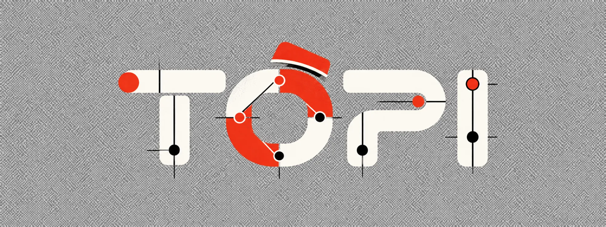
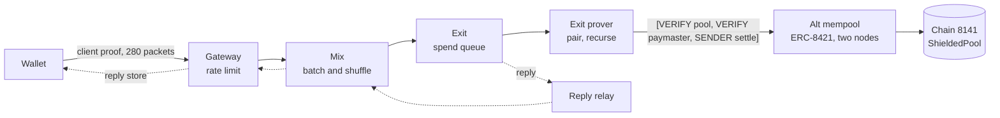

<p align="center">
  
</p>

<p align="center">
  <strong>Post-quantum private payments on Ethereum, built on EIP-8141 frame transactions.</strong>
</p>

<p align="center">
  <a href="https://usetopi.pages.dev">Website</a> ·
  <a href="whitepaper">Whitepaper</a> ·
  <a href="docs">Documentation</a> ·
  <a href="#architecture">Architecture</a> ·
  <a href="#quick-start">Quick start</a> ·
  <a href="#the-topi-terminal">Terminal</a> ·
  <a href="#repository">Repository</a> ·
  <a href="SECURITY.md">Security</a>
</p>

<p align="center">
  
  
  
  
  
</p>

---

Topi moves value privately without relying on elliptic curves or pairings anywhere on the path. A wallet
proves a withdrawal from a shielded pool in zero knowledge and sends the proof through a post-quantum
mixnet. The exit pairs spends, folds their proofs by recursion into a single proof the chain verifies,
and settles them in one frame transaction authorized by hash-based signatures, submitted through an
ERC-8421 alternative mempool built for the pool's settles. A Lean 4 model of the
pool's validation and settlement carries machine-checked theorems, and is tested against the live chain.

## Post-quantum at every layer

| Layer | Construction | Assumption |
|---|---|---|
| Transport | KEM-Sphinx packets, an X-Wing (ML-KEM-768 + X25519) encapsulation per hop, fixed 8 KB, batching mix, single-use reply blocks | lattices (and X25519 for classical security) |
| Spam protection | anonymous per-epoch rate limiting with Binius64 zero-knowledge tickets over SHA-256 | hashes |
| Spend proofs | Spartan-WHIR client proofs, leanVM recursion, a WHIR terminal verifier on chain | hashes |
| Authorization | leanSPHINCS signatures in EIP-8141 ARBITRARY signature entries, for the paymaster and user accounts | hashes |
| Assurance | a Lean 4 model with machine-checked theorems, differential tests against the chain | the Lean kernel |

## Architecture



1. **Deposit.** A leanSPHINCS-authorized account deposits a note commitment into the pool.
2. **Prove.** The wallet rebuilds the pool's trees from its events and proves a withdrawal in zero
   knowledge (about a second, 450 MB).
3. **Send.** The proof travels as fixed-size packets through four nodes in four regions, on one anonymous
   rate-limit token. The exit acknowledges it on the sender's single-use reply block.
4. **Aggregate.** The exit checks each spend against the chain, pairs two, and runs leanVM recursion into
   one WHIR terminal proof: about 19 minutes and 12 GB on a laptop, about 2.5 minutes on one 32-vCPU
   AWS instance (`EXIT_PROVER=aws`).
5. **Settle.** One frame transaction verifies the terminal proof, binds it to both spends' statements,
   spends both nullifiers, pays out, and inserts the change notes. The paymaster's operator signs with
   leanSPHINCS, so no ECDSA key touches the pool. The settle goes to the topi privacy-pool mempool,
   an ERC-8421 alternative mempool whose nodes check it, gossip it and relay it to the chain.

Measured on the testnet: settles in blocks 557893, 558272 and 612907 at about 16.3M gas (of the 2^24
transaction cap); settles through the alt mempool in blocks 717928, 719307, 720937, 721379 and 721480;
a ping round trip across all four regions in 4 to 10 s; a 1.3 MB spend queued at the exit in about a
minute over a mobile uplink. From two notes to a mined settle takes about 216 to 301 s with the exit
prover on AWS, and about 20 minutes with it on a laptop.

## Quick start

```bash
cargo install --locked --git https://github.com/Naveen-6087/topi topi-tui topi-mixnet   # topi, topi-node, topi-client
topi                                                                                  # from any folder
```

The repository is private, so this needs access to it. From a checkout:

```bash
git clone --recurse-submodules <repository>
cd <repository>
cp .env.example .env
cargo install --path crates/console && cargo install --path crates/mixnet
topi
```

`topi wallet`, `topi map` and `topi chain` open on that tab. On the Wallet tab, `F` funds the demo
accounts and `D` runs a whole private payment. The release workflow (`.github/workflows/release.yml`)
builds `topi`, `topi-node` and `topi-client` for Linux, macOS and Windows on a `v*` tag; no release has
been published yet.

From the command line:

```bash
target/release/topi-client register --identity .secrets/member.id --members data/members.txt
target/release/topi-client ping --topology data/local/topology.json --identity .secrets/member.id
```

A private payment end to end (deposit, client proof, mixnet, exit proof, settle) needs the
[prover](prover) and testnet funds; the [private payment guide](docs/guides/private-payment.mdx) walks
through it.

## The topi terminal

`topi` is a terminal interface over the whole system. Every action runs a real command, and its output
streams into a jobs pane. Full key list: [crates/console](crates/console/README.md).

| Tab | Shows | Main keys |
|---|---|---|
| 1 Wallet | accounts, notes and their stage, the exit prover | `c` account, `n` note, `d` deposit, `w` witness, `p` prove, `s` send, `m` alt mempool, `r` settle, `e` mempool explorer, `F` fund, `D` full demo |
| 2 Mixnet map | the nodes on a world map (four local nodes, or the AWS regions Mumbai, Frankfurt, N. Virginia and Singapore), packets in flight | `l` start local, `k` stop, `p` ping, `z` zoom |
| 3 Chain | balances, the pool's deposits and settles | `o` the chain's explorer (Dora on 8141) |

`F` tops the depositing key and the paymaster up to 0.04 ETH from the console's accounts and the
leanSPHINCS account. `D` funds first, then creates an account if needed, makes two notes, deposits,
witnesses, proves and sends them through the mixnet, and runs the exit prover to settle them.

`topi` embeds the files it runs besides its own code: the prover scripts, the alt mempool sidecar's
setup, patch, rules and policy, the TypeScript SDK sources, the AWS scripts, the deployment records and
the contracts' bytecode. Outside a checkout it unpacks them into `~/.topi` (or `TOPI_HOME`);
`TOPI_BUNDLED=1` forces that. It drives external tools: WSL on Windows (the prover and the sidecar run
on Linux), Bun, `lsk` (`LSK_BIN`), and the AWS CLI with Terraform for the cloud.

## Alternative mempool

A settle cannot use the public mempool: every settle has the same sender (the pool) and the same
paymaster, and its validation needs 160,100 gas (pool 10,000, PQ paymaster 150,000, signature 100),
more than the public 100,000. [mempool/](mempool) defines the topi privacy-pool mempool, an ERC-8421
alternative mempool. Its id is the IPFS hash of [mempool/RULES.md](mempool/RULES.md):
`QmSwvDuyR1MBau6NdGtWv91dcrz6doYvVfZDTWNFk9wNRh`.

It runs on the ERC-8421 sidecar (forshtat/mempool-workshop-sidecar, pinned) with a patch that adds a
per-mempool validation budget, an admission policy, untraced nodes for chain 8141, and a larger gossip
frame limit. Two nodes gossip over libp2p; the console's `m` key starts both. The same settle shape was
also admitted by the organizers' ERC-8421 devnet (chain 1337) with full ERC-7562 tracing and mined in
block 8944. See [mempool/README.md](mempool/README.md) and the
[alt mempool page](docs/architecture/alt-mempool.mdx).

## Exit prover on AWS

`infra/aws/prover.sh up|setup|prove|status|ssh|down` runs the exit's recursion on one `c7i.8xlarge`
spot instance (32 vCPU, 64 GiB) in ap-south-1, at about 0.47 USD per hour. `setup` takes about 6
minutes once per instance. With `EXIT_PROVER=aws` in `.env`, the console and the scripts prove there:
151 s on a warm instance, 210 to 332 s on a fresh one. See [infra/aws](infra/aws/README.md).

## Repository

| Component | Description |
|---|---|
| [`crates/sphinx`](crates/sphinx) | KEM-Sphinx packet format: X-Wing per hop, fixed size, replies |
| [`crates/ratelimit`](crates/ratelimit) | anonymous rate limiting with Binius64 zero-knowledge epoch tickets |
| [`crates/mixnet`](crates/mixnet) | mixnet nodes and client: `topi-node`, `topi-client` |
| [`crates/console`](crates/console) | the terminal: `topi` |
| [`contracts`](contracts) | Solidity library: `ShieldedPool`, Yul accounts, interfaces, the terminal verifier |
| [`lean`](lean) | Lean 4 model and proofs, with its [soundness statement](lean/SOUNDNESS.md) |
| [`prover`](prover) | client and exit proving on pinned upstream provers |
| [`sdk`](sdk) | TypeScript SDK, `@topi/sdk` |
| [`scripts`](scripts) | wallet, settle, exit prover and differential tests on the SDK |
| [`mempool`](mempool) | the ERC-8421 alt mempool: rules, admission policy, sidecar patch |
| [`infra/aws`](infra/aws) | a four-region mixnet with Terraform, and the exit prover instance |
| [`deployments`](deployments) | deployed addresses on chain 8141 and the ERC-8421 devnet (chain 1337) |
| [`docs`](docs) | documentation site (Mintlify) |
| [`website`](website) | landing page |
| [`whitepaper`](whitepaper) | the whitepaper, in LaTeX |

Operations: [METRICS.md](METRICS.md) lists every Prometheus metric the nodes export.

## Formal verification

The [Lean model](lean) transcribes the pool account's and both paymasters' validation, and the
settlement state machine, and proves among others:

- an approved pool transaction has exactly three frames, and only `settle` runs as the pool;
- the pool never pays its own gas; the paymasters pay only for correctly authorized transactions;
- no nullifier is ever spent twice, over any history;
- a reverted settle changes nothing, so its notes stay spendable;
- the pool's balance always equals the value of its live notes;
- with the post-quantum paymaster, no signature on the pool path is ECDSA.

All proofs depend only on `propext` and `Quot.sound` (`lake env lean Audit.lean`). Where the model ends
and what it assumes are written down in [SOUNDNESS.md](lean/SOUNDNESS.md). The alt mempool and
`DevnetSettle` (a devnet stand-in for the pool logic on chain 1337) are outside the model.

## Development

```bash
cargo test --workspace --release
(cd contracts && forge test && bash script/build-yul.sh --check)
(cd lean && lake build && lake env lean Audit.lean)
npm ci && npm test
```

See [CONTRIBUTING.md](CONTRIBUTING.md) for the layout and conventions.

## Status

Research software on a test network. It is not audited and must not protect real funds. Known limitations
are listed in [SECURITY.md](SECURITY.md).

## License

Licensed under either of [Apache License 2.0](LICENSE-APACHE) or [MIT](LICENSE-MIT), at your option.
