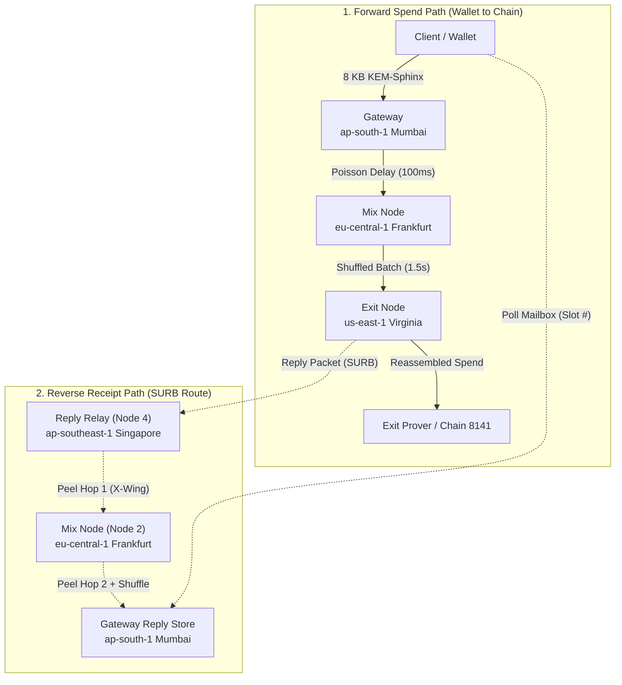

# Architecture Guide: The Reply Relay & Single-Use Reply Blocks (SURBs)

> **Component:** `Role::ReplyRelay` (Role ID `4`)  
> **Network Port:** `47104` (Relay), `47300` (Stats), `47400` (Prometheus Metrics)  
> **Default Testnet Region:** `ap-southeast-1` (Singapore)  
> **Source Files:** [`crates/mixnet/src/node.rs`](file:///home/vishal/Projects/EGM/crates/mixnet/src/node.rs), [`crates/sphinx/src/lib.rs`](file:///home/vishal/Projects/EGM/crates/sphinx/src/lib.rs), [`crates/mixnet/src/replies.rs`](file:///home/vishal/Projects/EGM/crates/mixnet/src/replies.rs)

---

## 1. Executive Summary

In traditional mixnets and onion routers (such as Tor), sending traffic backward from an exit node to an anonymous client is notoriously challenging. Most end users connect from laptops or mobile phones behind home routers and carrier firewalls (**NAT**), which block inbound socket connections. Furthermore, if an exit node could directly connect back to a user, the user's IP address and identity would be unmasked instantly.

Topi solves this using **Single-Use Reply Blocks (SURBs)** combined with a dedicated **Reply Relay**:
1. **The Client** builds a pre-addressed, multi-hop return envelope before sending its payment.
2. **The Exit Node** delivers the receipt into this envelope without ever learning who the client is or where they live.
3. **The Reply Relay in Singapore** acts as the crucial first hop on the reverse journey, ensuring that the Exit Node learns nothing about the user's home gateway or geography.
4. **The Gateway in Mumbai** holds the encrypted receipt in an in-memory **Reply Store** mailbox until the NAT-restricted client polls and retrieves it.

---

## 2. Global Network Topology & The Reverse Path

The network path is strictly asymmetrical. While payments travel forward from India to the USA, receipts travel on a completely distinct reverse route:



---

## 3. Why a Dedicated Reply Relay is Required

One might ask: *“Why can’t the Exit Node in Virginia send the receipt directly back to Germany or India?”*

There are two critical security reasons:

### A. Preventing Geographic & Gateway Fingerprinting
If the Exit Node in Virginia transmitted replies straight to the Gateway in Mumbai, the Exit Node would learn:
> *"Whoever sent this spend is serviced by the Mumbai Gateway."*

By forcing the Exit Node to hand all replies exclusively to the **Reply Relay in Singapore**, the Exit Node sees only Singapore. It has **zero visibility** into whether the final client resides in India, Europe, Japan, or the Americas.

### B. Decoupled Jurisdiction (The 4-Continent Defense)
By placing the 4 nodes in 4 distinct legal jurisdictions:
* Gateway: **India** (`ap-south-1`)
* Mix: **Germany** (`eu-central-1`)
* Exit: **United States** (`us-east-1`)
* Reply Relay: **Singapore** (`ap-southeast-1`)

An adversary seeking to correlate ingress and egress traffic by subpoena or physical wiretapping must simultaneously breach telecommunications and legal boundaries across four sovereign territories.

---

## 4. Cryptographic Mechanics of a SURB

A Single-Use Reply Block is created entirely on the client's laptop inside [`crates/mixnet/src/client.rs`](file:///home/vishal/Projects/EGM/crates/mixnet/src/client.rs):

```rust
// crates/mixnet/src/client.rs
let back = [key(Role::ReplyRelay)?, key(Role::Mix)?, key(Role::Gateway)?];

// Generate a random 16-bit mailbox slot ID (e.g., Slot #48291)
let slot = 1000 + (random_u64() % 60000) as u16;

let surb = build_surb(
    &back,
    &[
        Routing { is_exit: false, next: Role::Mix.id(), delay_ms: exp_delay_ms(self.mean_delay_ms) },
        Routing { is_exit: false, next: Role::Gateway.id(), delay_ms: 0 },
        Routing { is_exit: true,  next: slot,           delay_ms: 0 },
    ],
);
```

### The Return Route Breakdown:
1. **Hop 1 (Reply Relay — Singapore):** Encapsulated with Singapore’s X-Wing public key.
   * `next`: Mix Node ID (`2`).
   * `delay_ms`: Randomized exponential delay.
2. **Hop 2 (Mix Node — Frankfurt):** Encapsulated with Frankfurt’s X-Wing public key.
   * `next`: Gateway ID (`1`).
   * `delay_ms`: `0` (mix node will pool and shuffle instead).
3. **Hop 3 (Gateway — Mumbai):** Encapsulated with Mumbai’s X-Wing public key.
   * `is_exit`: `true`.
   * `next`: `slot` (The secret mailbox ID where the reply will be parked).

---

## 5. Wire-Level Packet Anatomy on the Reverse Path

Every return packet remains strictly **8,192 bytes** at every hop.

```text
 ┌───────────────────────── RETURN PACKET: 8,192 BYTES ────────────────────────┐
 │                                                │                           │
 │        SPHINX HEADER: 3,504 bytes              │   PAYLOAD: 4,688 bytes    │
 │  ┌──────────────┬──────────────┬─────────────┐ │ ┌────────────┬──────────┐ │
 │  │ Hop 1 (SG)   │ Hop 2 (DE)   │ Hop 3 (IN)  │ │ │ 16-byte E2E│ Confirmed│ │
 │  │ X-Wing CT    │ X-Wing CT    │ X-Wing CT   │ │ │ Auth Tag   │ Receipt  │ │
 │  │ (1120 bytes) │ (1120 bytes) │ (1120 bytes)│ │ │            │ Data     │ │
 │  └──────────────┴──────────────┴─────────────┘ │ └────────────┴──────────┘ │
 └────────────────────────────────────────────────┴───────────────────────────┘
```

When the Exit Node responds:
1. It takes the client's pre-computed `surb.header` (3,504 bytes).
2. It encodes its response body (*"Spend queued!"*) into the payload area (4,688 bytes).
3. It calls `reply_packet(&surb.header, &receipt_bytes)` and dispatches it over TCP to port `47104` on the Reply Relay in Singapore.

---

## 6. How the Reply Relay Processes Packets

Inside [`crates/mixnet/src/node.rs`](file:///home/vishal/Projects/EGM/crates/mixnet/src/node.rs), the Reply Relay runs the standard Sphinx `process()` pipeline:

```rust
// crates/mixnet/src/node.rs
let p = match process(&sk, &pkt, &mut seen.lock().unwrap()) {
    Ok(p) => p,
    Err(e) => {
        let _ = events.send(Event::Rejected(e.into()));
        return;
    }
};
```

### The Step-by-Step Processing Cycle:
1. **Lattice Decapsulation:** Uses Singapore’s private key (`reply-relay.key`) to decapsulate Hop 1's X-Wing ciphertext, deriving the 32-byte shared secret `ss`.
2. **Key Derivation (BLAKE3):** Derives 4 keys from `ss`:
   * `k.mac`: Verifies Hop 1 MAC integrity.
   * `k.header`: Unwraps the routing label (`next = Mix Node`).
   * `k.payload`: Strips one layer of payload encryption.
   * `k.replay`: Produces the unique 32-byte replay fingerprint.
3. **Single-Use Verification (Replay Protection):**
   ```rust
   if seen.contains(&k.replay) {
       return Err(HopError::Replay); // Drop duplicate packet!
   }
   seen.insert(k.replay);
   ```
   If an adversary or buggy exit node attempts to reuse the same return envelope a second time, the Reply Relay detects the duplicate tag and drops it immediately.
4. **Header Shifting & Filler Addition:** The processed header slice is shifted off, and 1,168 bytes of deterministic pseudo-random filler are appended to the tail using BLAKE3 XOF.
5. **Forwarding:** The packet (still precisely 8,192 bytes) is forwarded over TCP to the Mix node in Frankfurt (`port 47102`).

---

## 7. The Final Delivery: Gateway Reply Store & NAT Traversal

Because the client is behind a home firewall (NAT), the packet cannot be pushed directly to the user's IP. 

Instead, the return envelope terminates at the **Gateway's Reply Store** in Mumbai ([`crates/mixnet/src/replies.rs`](file:///home/vishal/Projects/EGM/crates/mixnet/src/replies.rs)):

```text
       [Exit (USA)] ──► [Reply Relay (SG)] ──► [Mix (DE)] ──► [Gateway (IN)]
                                                                    │
                                                     Stores in Memory:
                                                     Slot #48291 = [8KB Encrypted Receipt]
                                                                    ▲
                                                     HTTP GET / 48291
                                                                    │
                                                        [Client Laptop]
```

### Protocol Details:
* **Deposit (`P | slot | packet`):** When the Gateway peels Hop 3 and sees `is_exit: true` with target `slot = 48291`, it deposits the 8 KB payload into an in-memory hash map under slot `48291`.
* **Fetch (`G | slot`):** The client polls `http://gateway-ip:47250/48291`.
* **Extraction:** The Gateway serves the 8 KB block and purges the slot from memory.
* **Client Decryption:** The client takes the raw payload, applies the XOR decryption keys it saved when it generated the SURB (`surb.keys`), checks the 16-byte authentication tag, and uncovers the receipt:
  ```json
  {"status": "queued", "spend_id": "0x7a8b...3f", "timestamp": 1730843400}
  ```

---

## 8. Summary of Node Properties

| Property | Value |
|---|---|
| **Role Name** | `Role::ReplyRelay` (`reply-relay`) |
| **Role ID** | `4` |
| **Default Relay Port** | `47104` |
| **Stats / Monitoring Port** | `47300` (JSON), `47400` (Prometheus) |
| **Ciphertext Format** | KEM-Sphinx (8,192 bytes constant length) |
| **KEM Algorithm** | X-Wing (ML-KEM-768 + X25519) |
| **Stream Cipher** | BLAKE3 XOF (Extendable Output Function) |
| **Replay Protection** | In-memory `HashSet<[u8; 32]>` with epoch clearing |
| **Primary Inbound Peer** | Exit Node (`Role::Exit`) |
| **Primary Outbound Peer** | Mix Node (`Role::Mix`) |
