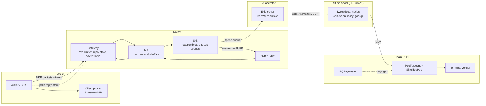
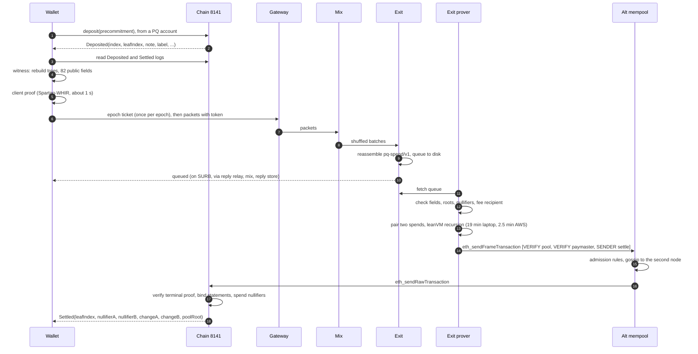

Topi has five parts: a wallet (the SDK and the client prover), a post-quantum mixnet, an exit prover that aggregates spends, an ERC-8421 alternative mempool for settles, and on-chain contracts on chain 8141. The mixnet carries only proofs and public fields; the exit learns which spends it pairs but not who sent them.

## Components

| Component | Code | Role |
|---|---|---|
| Wallet / SDK | `sdk/`, `scripts/` | Note secrets, deposits, tree rebuild from events, frame transaction building, mixnet submission |
| Client prover | `prover/prove-client.sh` | One full zero-knowledge withdrawal proof per spend |
| Gateway | `crates/mixnet` (`gateway` role) | First hop; admits packets with anonymous rate-limit tokens; hosts the reply store; emits cover traffic |
| Mix | `crates/mixnet` (`mix` role) | Second hop; collects packets for a batch interval and releases them shuffled |
| Exit | `crates/mixnet` (`exit` role) | Third hop; reassembles fragments, answers pings, queues pool spends on disk |
| Reply relay | `crates/mixnet` (`reply-relay` role) | First hop of the reply path |
| Exit prover | `prover/prove-exit.sh`, `scripts/`, `infra/aws/prover.sh` | Checks and pairs queued spends, runs the recursion (locally or on AWS), signs the settle |
| Alt mempool | `mempool/` | Checks each settle against its rules, gossips it between nodes, relays it to the chain |
| Contracts | `contracts/` | Pool account policy, deposits, settle, paymasters, terminal verifier |

The forward route is always gateway, mix, exit. The reply route is reply relay, mix, gateway: the exit answers on the single-use reply block (SURB) that rode in the message's first fragment, and the reply waits in the gateway's reply store under a slot only the sender knows. The client polls for it, so it never accepts inbound connections and works behind any NAT.

## Lifecycle of a private spend

1. **Deposit.** The wallet calls `deposit(precommitment)` with value. The pool assigns a label, computes the note commitment on chain and inserts it into the pool tree; the label goes into the association tree.
2. **Witness.** The wallet rebuilds both trees from `Deposited` and `Settled` events and builds the withdrawal input: recipient, amount, fee, fee recipient and a change note.
3. **Client proof.** A Spartan-WHIR proof that the 82 public fields describe a valid withdrawal from a note in the tree. The only public input of the lean statement is the transaction digest of those fields.
4. **Mixnet.** The proof (about 1.3 MB) and its fields are framed as a `pq-spend/v1` message and split into about 280 packets of 8,192 bytes, all admitted on one rate-limit token.
5. **Queue.** The exit reassembles the message, checks its framing, writes it to the spend queue and acknowledges on the SURB.
6. **Pairing.** The exit prover checks each queued spend cheaply (pool and scope, fee recipient, known roots, unspent nullifier, fields match the proof's statement) and pairs two.
7. **Recursion.** leanVM verifies both client proofs and produces one grouped Keccak WHIR terminal proof whose application root commits to both statements.
8. **Settle.** A frame transaction with the pool as sender: the pool's VERIFY frame approves execution, the paymaster's VERIFY frame checks the exit's leanSPHINCS signature and approves payment, and the SENDER frame calls `settle`. The exit prover submits it to the alt mempool, whose nodes check it, gossip it and relay it to the chain (about 20 s to mined).
9. **Events.** `settle` verifies the terminal proof, recomputes the application root from both spends' fields, consumes two nullifiers, inserts both change notes, pays recipients and fees, and emits `Settled`.

## Pages in this section

<CardGroup cols={2}>
  <Card title="Mixnet" href="/architecture/mixnet">Packets, roles, batching, replies.</Card>
  <Card title="Rate limiting" href="/architecture/rate-limiting">Epoch tickets, tokens, continuation budgets.</Card>
  <Card title="Shielded pool" href="/architecture/shielded-pool">Notes, trees, nullifiers, settle.</Card>
  <Card title="Proof system" href="/architecture/proof-system">Client proofs, recursion, terminal verifier.</Card>
  <Card title="Post-quantum accounts" href="/architecture/post-quantum-accounts">Frames, ARBITRARY entries, leanSPHINCS.</Card>
  <Card title="Formal verification" href="/architecture/formal-verification">The Lean model and its theorems.</Card>
  <Card title="Alternative mempool" href="/architecture/alt-mempool">The ERC-8421 mempool for settles.</Card>
</CardGroup>
