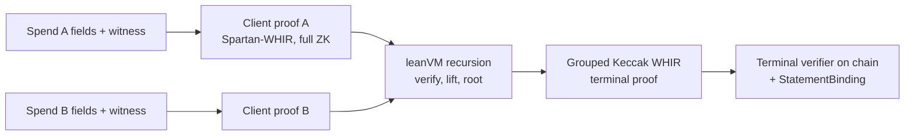

Every proof in the spend path is hash-based. A wallet makes a small zero-knowledge proof per spend; the exit compresses two of them into one terminal proof that a generated Solidity verifier checks on chain.



## Client proof

| | |
|---|---|
| Prover | `ethereum/spartan-whir`, binary `leanvm-full-zk-spark-fixture --circuit privacy-pools-lean` |
| Relation | Privacy Pools withdrawal: note in the pool tree, label in the association tree, nullifier, change note |
| Statement | Lean: the only public input is the 8-element transaction digest of the 82 spend fields |
| Zero knowledge | Full (the inner witness and the 82 fields stay private to the proof) |
| Cost | About 1 s to prove, about 450 MB peak, a few seconds wall time including setup |
| Output | A proof directory packed as `.tar.gz`, about 1.3 MB |

The wallet input comes from `pool-wallet witness`, which reads the note, the chain view (both trees and current roots) and the withdrawal request, and also writes the 82 public fields. See [Run the prover](/guides/prover).

## Exit proof

| | |
|---|---|
| Prover | `Client-Side-Proving/leanVM` (`script/run_terminal_fixture.py`) |
| Input | Two client proofs |
| Steps | Verify each client proof inside leanVM, lift, then a grouped root recursion |
| Output | A grouped Keccak WHIR terminal proof and the calldata for `verifyGroupedLogupV1`, about 100 KB |
| Cost | About 19 minutes (1,150 s measured) and about 12 GB of memory on a laptop; 151 s warm, 210 to 332 s fresh, on a 32-vCPU `c7i.8xlarge` ([AWS prover](/guides/aws#exit-prover)) |

`prove-exit.sh` then checks that the proof's guest program hashes equal those in `contracts/test/fixtures/terminal/manifest.json`, the programs the deployed terminal verifier was generated for. A different circuit or upstream commit needs a new terminal verifier.

## On-chain verification

The terminal verifier (`LeanVmGroupedTerminal_KeccakPow28T6Lean`, generated by `ethereum/sol-whir-p3`) returns only `bool`: "these fixed programs accepted two proofs whose statements hash to `applicationRoot`". It does not look at public inputs. `ShieldedPool.settle` therefore recomputes, for each spend:

```text
txDigest  = Poseidon2 hash_fields(TRANSACTION, fields[0..82])
statement = Poseidon1 length-prefixed digest over ["leanvm-spartan-whir-statement-v1", txDigest]
```

and the application root `Poseidon1(NOD1, 2, 0..., statementA, statementB)`, and requires it to equal the `applicationRoot` at calldata offset 100. `StatementBinding` implements both digests; the constant prefix blocks are precomputed to save permutations.

Verification of the terminal proof costs about 10M gas including its calldata; the full settle with binding, nullifiers, the paired insert and payouts is about 16.3M.

## Pinned upstream commits

`prover/env.sh` pins the upstream repositories to the commits the deployed terminal verifier was generated from:

| Repository | Commit |
|---|---|
| `ethereum/spartan-whir` | `14d6da4211eda59e65cfd0af5e2dcd89d523edc3` |
| `Client-Side-Proving/leanVM` | `fb0909d0dc3ab4cffd1910c065998effd44a5ee3` |
| `ethereum/sol-whir-p3` | `b82359ec98e1e3c9f6f39ebf984e7aefb0eeb9be` |

## Caveats

- The upstream recursion reports that full composition security is not yet established.
- All three upstream projects are research code and unaudited.
- The exit sees the public fields of the spends it pairs (amounts, recipients, nullifiers), as the chain does after settlement. It does not see note secrets or the sender's network address.
